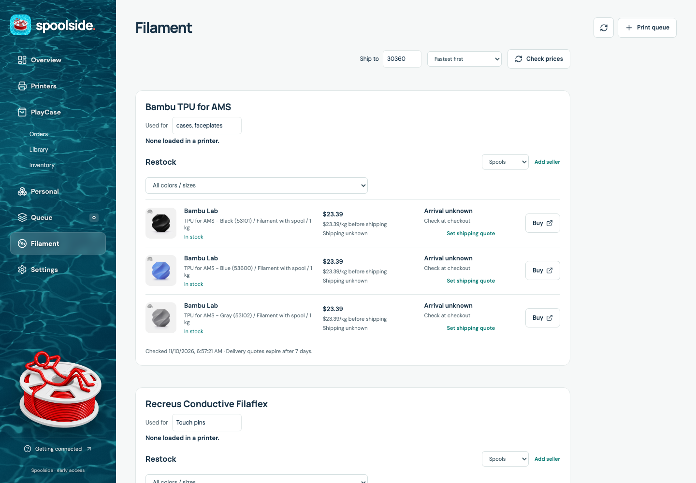
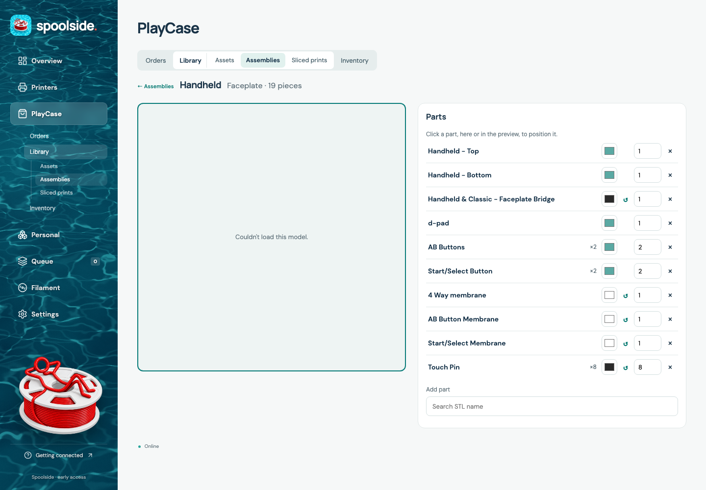
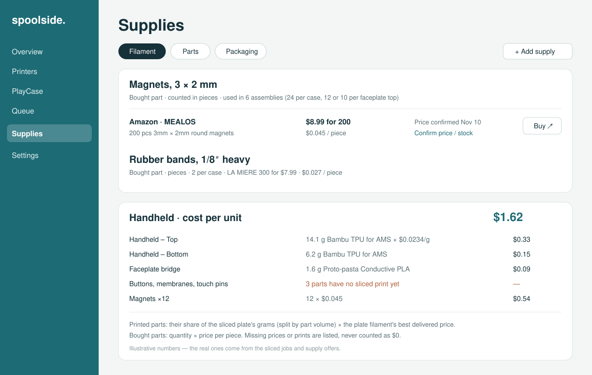
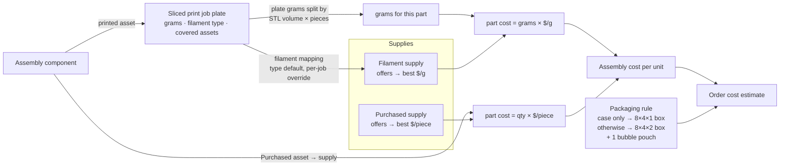

# Supplies and assembly costs

Issue: https://github.com/shelbyklein/spoolside/issues/18 · Plan date: 2026-11-10 · Baseline: `origin/main` @ `eb64227`

## Summary

Spoolside's Filament page can only track three hard-coded filaments, priced per kilogram. PlayCase products also use bought parts: magnets, rubber bands, boxes and bubble pouches. Spoolside has no way to record those parts or to say what a case or faceplate costs to make.

This plan widens Filament into **Supplies**, adds a **Purchased** asset type so bought parts can sit in assemblies, and shows a **cost per unit** for every assembly, plus a packaging cost per order. Costs only: supply stock counting is out of scope.

## Problem

Today:

- **Fixed filament list.** `server/materials.mjs:3` hard-codes three filaments (`MATERIALS`).
- **Offers are filament spools only.** `addOffer` rejects anything that isn't a 1.75 mm spool of 100–10000 g (`materials.mjs:86`, "Enter exact 1.75 mm spool, seller, price and grams"). Every offer reduces to $/kg (`perKg`, `deliveredPerKg`, `materials.mjs:59`).
- **No bought-part asset type.** Asset types are `Case, Faceplate, Sleeve, Part, Phone, Cut template` (`server/assets.mjs:7`). A magnet can't be modelled. As a `Part` it would need an STL.
- **Readiness would count purchased parts as print pieces.** `orderRequirements` treats every assembly component that isn't a `Part` as a piece to print (`server/readiness.mjs:30`). A magnet added under a new type would show up as unprinted pieces.
- **No cost anywhere.** Assemblies hold `assetId`, `quantity`, `color` and `positions` (`server/assets.mjs`, `saveAssembly`). Print-library plates hold total `grams`, `filaments [{id,type,color}]`, `coverage` (which assets the plate prints) and `quantity` (`server/library.mjs:131`, `:215`, `:199`). Nothing combines these with prices.
- **Inventory only counts finished cases and faceplates, by hand** (`server/inventory.mjs:3`).

Who it affects: Shelby, when pricing products, checking margins, and reordering supplies. Today that's done by hand outside Spoolside.

Current screens:

## Desired behaviour

Target mockup (illustrative numbers): [target-supplies.svg](assets/supplies-costs/target-supplies.svg)

How a cost is worked out:

## Settled decisions

- **Units.** Each supply has a unit: grams for filament, pieces for bought parts. An offer is "price for N units"; it reduces to a delivered price per unit. Filament keeps its existing $/kg display.
- **Supplies to seed.** Shelby gave these on 2026-11-10. They're manual offers ("confirm price"), because Amazon blocks automatic price checks.

  | Supply | Group | Offer | Per piece | Link |
  |---|---|---|---|---|
  | Magnets, 3 × 2 mm (MEALOS) | Parts | 200 for $8.99 | $0.045 | https://www.amazon.com/dp/B08NZTN426 |
  | Rubber bands, 1/8″ heavy (LA MIERE, non-latex) | Parts | 300 for $7.99 | $0.027 | https://www.amazon.com/dp/B0B52ZYYWJ |
  | Box, 8 × 4 × 1″ white mailer (Myunzi) | Packaging | 50 for $24.99 | $0.50 | https://www.amazon.com/dp/B0F2MVTYVM |
  | Box, 8 × 4 × 2″ kraft mailer (Wintcomfort) | Packaging | 25 for $21.99 | $0.88 | https://www.amazon.com/dp/B0BC7D79V7 |
  | Bubble pouch, 4 × 8″ (Lswteiz) | Packaging | 200 for $21.99 | $0.11 | https://www.amazon.com/dp/B0CRCSWFRX |

- **Filaflex 70A** (membranes; Shelby, 2026-11-10): a fourth built-in filament with live price checks from https://recreus.com/en-en/products/filaflex-70a?variant=45921629241603. The existing parser reads its 12 variants. The linked variant is Transparent 500 g, $54.90 ($109.80/kg); 3 kg spools are $209.90.
- **Quantities in assemblies.** 24 magnets and 2 rubber bands per case. 12 magnets per Handheld or Classic top (standard and Plus), 10 per DS or DS Plus top.
- **Box rule (Shelby, 2026-11-10: "by what's in the order").** An order with a case and nothing else gets the 8 × 4 × 1″ box. Any order with a faceplate or more than one item gets the 8 × 4 × 2″ box.
- **Bubble pouches.** 1 per order by default; the number is a setting.
- **Stock (Shelby, 2026-11-10: "cost only, no stock").** No supply stock counting or deduction.
- **Printed-part grams.** A plate's grams are split between the assets it covers by STL volume × pieces on the plate. When a plate has several filaments and Orca recorded per-filament weights, each filament's grams are used. Otherwise the plate's filament list is split evenly and the result is marked "estimated".
- **Filament mapping.** Each plate filament type maps to a supply. The defaults are TPU-AMS → Bambu TPU for AMS, and PLA → Proto-pasta Conductive PLA. Each print job can override its mapping; "TPU" needs one, since it covers both conductive Filaflex and Filaflex 70A. The live library today has types TPU-AMS (15 plates), TPU (6) and PLA (11).
- **Missing data is never $0.** A part with no linked sliced print, no filament mapping or no supply price is listed as missing. The total says "at least $X".

## Success criteria

1. **Supplies page.** It lists the three existing filaments, unchanged, plus the five seeded supplies with their per-unit prices. Verified on the deployed site (desktop and iPhone width) and by `tests/supplies.spec.ts`.
2. **Purchased parts.** A Purchased asset with no STL can be added to an assembly with a quantity. It does not appear as a piece to print in order readiness or the print plan. Verified by `server/readiness.test.mjs` and a browser check on an order.
3. **Assembly cost.** Each assembly shows a cost per unit with a per-part breakdown and any missing items. Handheld's total matches a hand calculation from its job's grams and the seeded prices, to within $0.01. Verified by `server/costs.test.mjs` and on the deployed Handheld assembly.
4. **Order cost.** An order shows an estimate: its case and faceplate assemblies plus the box chosen by the rule plus bubble pouches. Verified by a server test and on a deployed order.
5. **No regressions.** Existing filament offers, live price refresh, ZIP/sort settings, delivery quotes, order readiness and inventory behave as before. Verified by the full `node --test server/*.test.mjs` and `npx playwright test` suites.

## Deliverables

| Item | End state |
|---|---|
| Server: supplies model and API (`server/materials.mjs` → supplies), `server/costs.mjs`, Purchased asset type, readiness exclusion | Committed and merged to `main` via PR |
| UI: Supplies page (`src/FilamentManager.tsx` → `src/Supplies.tsx`), assembly cost panel, order cost line, per-job filament mapping | Committed and merged |
| Seed data: five supplies with offers; Purchased assets Magnet and Rubber band; magnets and bands added to the six faceplate assemblies (bands wait for case assemblies) | Applied on the live server after the deploy gate |
| Tests: server unit tests and Playwright specs listed below | Committed, all passing |
| Docs: this plan with delivery evidence; README "Supplies" section | Committed |
| Deploy to Beelink (`/srv/projects/spoolside`) | **Awaiting Shelby's go-ahead** (gate G1) |

## Tasks

| ID | Task | Depends on | Acceptance check |
|---|---|---|---|
| T1 | **Supplies data model.** Add Filaflex 70A to the built-in filaments, with its Recreus source for live refresh. Extend the catalogue rows with `kind` (`filament`, `part` or `packaging`) and `unit` (`g` or `piece`). Existing rows become `filament`/`g`. Offers gain `quantity` (grams or pieces) and `unitPrice`/`deliveredUnitPrice`, keeping `perKg`/`deliveredPerKg` for filament. Filament keeps the 1.75 mm and spool-weight checks; part and packaging offers need price > 0 and quantity ≥ 1. Add create/rename/remove supply (only supplies no asset references can be removed). | — | `node --test server/materials.test.mjs`: existing tests pass unchanged. New tests cover piece offers, unit price, validation per kind, and a migrated DB keeping existing offers and quotes. |
| T2 | **API.** `/api/supplies` (GET, POST supply, PATCH, DELETE) and `/api/supply-offers`. Keep `/api/materials` and `/api/material-offers` working as aliases returning filament supplies, so the MCP server and older clients keep working. | T1 | `node --test server/server.test.mjs`: new routes need auth; the old `/api/materials` response shape is unchanged. |
| T3 | **Purchased asset type.** Add `Purchased` to `TYPES`, with a required `supplyId` linking to a part or packaging supply. STL is optional and used for previews only. In `orderRequirements`, skip `Purchased` components the same way as `Part` (`readiness.mjs:30`). Coverage and print plans ignore them. | T1 | `node --test server/assets.test.mjs server/readiness.test.mjs`: a Purchased asset saves without an STL; an assembly with 12 magnets gives the same readiness groups and pieces as before. |
| T4 | **Filament mapping.** Settings hold the default map from plate filament type to supply. Each library job can override it per filament id. Read Orca's per-filament `used_g` from `slice_info.config` when present. | T1 | Unit test: a plate with TPU-AMS maps to Bambu TPU; an override sends job X's TPU to Recreus; per-filament grams are parsed from a fixture with two filaments. |
| T5 | **Cost roll-up** (`server/costs.mjs`, `GET /api/assemblies/:id/cost`, `GET /api/orders/:id/cost`). Printed component: the PlayCase-library plate covering the asset, its grams split by STL volume × pieces on the plate (compute and store asset volume on STL upload, and backfill existing assets), × the mapped supply's best delivered $/g. Purchased component: quantity × the supply's best delivered $/piece. Order: its case (case asset, or case assembly when one exists) + faceplate assemblies + box rule + bubble pouches × setting. Return `total`, `complete` and `parts[]` with reasons for anything missing. | T3, T4 | `node --test server/costs.test.mjs`: fixture assembly and job give the hand-calculated total; a missing job or price gives `complete: false` and the reason; box rule cases: case only → 1″ box, case + faceplate → 2″, two cases → 2″. |
| T6 | **Supplies page UI.** Rename the Filament tab to Supplies (redirect `/filament` → `/supplies`), with Filament / Parts / Packaging groups. Add supply form with name, group, unit and link. Offer form asks for grams or pieces by unit. Show per-unit price; filament still shows $/kg. Loaded-spools display is unchanged. | T2 | `npx playwright test tests/supplies.spec.ts tests/spools.spec.ts tests/dashboard.spec.ts`. Screenshots of the rendered Supplies page at 1440 × 1000 and 428 × 926 are inspected for overflow and layout. |
| T7 | **Cost UI.** Assembly detail gets a "Cost per unit" panel (mockup above). Assembly cards show the total. Each order shows an "Est. cost" line. Library jobs show the filament mapping, with an override picker per filament. Asset editor allows type Purchased with a supply picker. | T5, T6 | `npx playwright test tests/assembly-costs.spec.ts`: the panel lists parts and the total, missing items are flagged, the override changes the total, and a Purchased asset can be created and added. Rendered-state screenshots are inspected. |
| T8 | **Full checks and docs.** Run the complete suites and build. Update the README Supplies section and this plan's delivery evidence. | T1–T7 | `node --test server/*.test.mjs`, `npm run build`, `npx playwright test` all pass. |
| G1 | **Gate: Shelby approves the deploy.** | T8 | Shelby says go. |
| T9 | **Deploy and seed.** Take the SQLite backup. Copy the changed files to Beelink and rebuild (`docker compose -f compose.yaml -f tunnel-compose.yaml up -d --build`). Seed the five supplies and offers, the Purchased assets Magnet (fit: 3 × 2 mm) and Rubber band, and add magnets to the six faceplate assemblies (12 / 12 / 12 / 12 / 10 / 10). | G1 | Container healthy. `GET /api/supplies` lists 8 supplies. `GET /api/assemblies/<Handheld>/cost` returns a total with magnets at $0.54. The live Supplies page and Handheld cost panel are checked in the browser. |
| G2 | **Gate: Shelby confirms the numbers look right** and the issue can close. | T9 | Shelby's confirmation in chat or on the issue. |

## Out of scope / must not change

- **Out of scope:**
  - Supply stock counting or deduction (Shelby: cost only).
  - Live price checks for Amazon listings.
  - Building case assemblies. Rubber bands and case magnets get added when those exist; that's separate work.
  - Labour, electricity, printer wear, platform or payment fees.
  - Selling prices and margins.
- **Must not change:**
  - Existing filament offers, quotes, live refresh, ZIP and sort settings.
  - Loaded-spool display.
  - `/api/materials` response shape.
  - Order readiness results and print plans for existing orders.
  - The hand-counted finished-goods inventory.
  - Assembly part positions, previews and thumbnails.
  - Existing assets and print jobs.

## Rollback

- **Before T9:** run the existing consistent SQLite backup (hourly job at `/srv/projects/spoolside/backups`) by hand. Copy the files being replaced to `backups/predeploy-supplies/`, as earlier deploys did.
- **Schema changes are additive:** new keys on catalogue and offer rows, a `volume` field on assets, new settings rows. Old code ignores them, so restoring the previous files and rebuilding rolls the app back.
- **Seeded rows:** old code would list the new part and packaging supplies on the Filament page. A full rollback also removes catalogue rows with `kind != 'filament'`, removes the two Purchased assets and their assembly components, or restores the pre-deploy backup.

## Test plan

- **Server:** `node --test server/*.test.mjs`. New or extended files: `materials.test.mjs`, `assets.test.mjs`, `readiness.test.mjs`, `library.test.mjs` (per-filament grams), `costs.test.mjs`, `server.test.mjs` (routes and auth).
- **Browser:** `npm run build && npx playwright test`. New specs: `tests/supplies.spec.ts`, `tests/assembly-costs.spec.ts`. Existing `spools`, `dashboard` and `assembly-parts` specs must still pass.
- **Rendered state:**
  - Real entry points: sidebar **Supplies**, then the Parts and Packaging groups; **PlayCase → Library → Assemblies → Handheld** for the cost panel; **PlayCase → Orders** for the order estimate.
  - Screenshots at desktop 1440 × 1000 and iPhone 428 × 926 are inspected for layout, overflow and missing-data states.
  - After deploy, the same checks run on https://spoolside.shelbyklein.com.

## Open questions (none blocking)

- **Bubble pouches per order:** 1 by default, adjustable in settings.
- **Case magnets and bands:** costed once case assemblies exist (separate work, already discussed).

## Work preparation

- **Confirmed scope:** Shelby asked on 2026-11-10 for this plan: generalize filament into supplies with units, magnets and bands as purchased parts, assembly cost roll-up. Boxes and bubble pouches were added the same day.
- **Decisions (Shelby, 2026-11-10):**
  - Boxes: by what's in the order.
  - Stock: cost only, no stock.
- **Plan:** `instructions/supplies-and-costs.md` (worktree `~/Vibes/worktrees/spoolside-supplies-plan`, branch `claude/supplies-plan`, from `origin/main` @ `eb64227`).
- **Mode:** `linear`. Tasks share `materials.mjs`, `assets.mjs`, `readiness.mjs` and the UI shell, so parallel lanes would collide.
- **Models:** current session, Claude Opus 5.5 (`claude-opus-5-5`); exact effort unavailable.
- **Now/later:** now (Shelby, 2026-11-10).
- **Readiness:** pass · 2026-11-10 · R1–R13 pass. R3: screenshots, mockup and flow diagram in `assets/supplies-costs/`. R7: tasks match issue #18's checklist. R12: rollback above.

## Delivery evidence

- **T1–T5 (server):** `node --test server/*.test.mjs` passes 105/105 (94 before this work, 11 new). `server/costs.test.mjs` hand-checks the Handheld example: top 20 g × $0.024, bottom 10 g, bridge 1 g × $0.09, 12 magnets × $0.045 = $1.35. It also covers the case-only/kit/two-case box rule, a per-print filament override, per-filament grams, missing-data reasons, and the authenticated API with `/api/materials` keeping its shape. `server/readiness.test.mjs` checks that readiness is identical with 12 magnets added.
- **T6–T7 (UI):** `npx playwright test` passes 40/40 (35 before, 5 new: `tests/supplies.spec.ts`, `tests/assembly-costs.spec.ts`). The existing Filament, spools and dashboard specs were updated for the tab rename; `/filament` lands on `/supplies`. Rendered states were inspected at 1440 × 1000 and 428 × 926:
  - `handoff/spoolside-supplies-parts-desktop.png`
  - `handoff/spoolside-supplies-packaging-desktop.png`
  - `handoff/spoolside-supplies-parts-iphone.png`
  - `handoff/spoolside-assembly-cost-desktop.png`
  - `handoff/spoolside-order-cost-desktop.png`
- **T8:** `npm run build` passes; README has a "Supplies and costs" section.
- **Deploy (G1 → T9):** waiting for Shelby's go-ahead.
