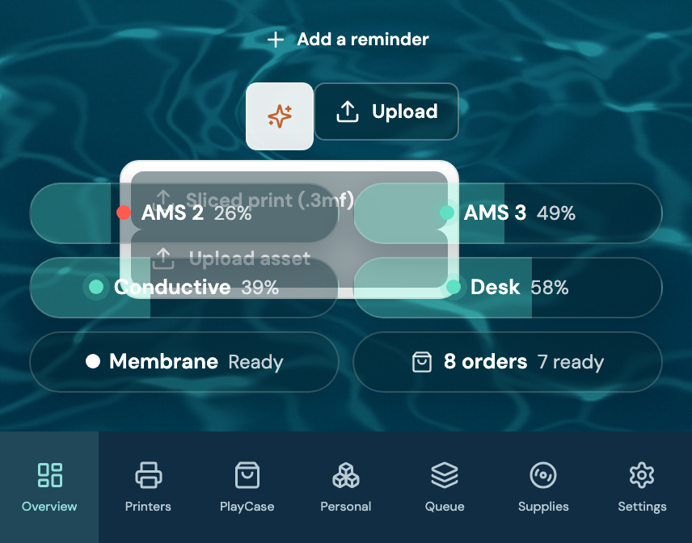
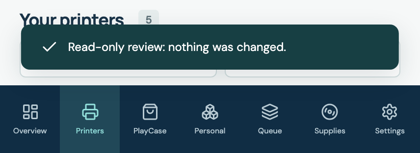
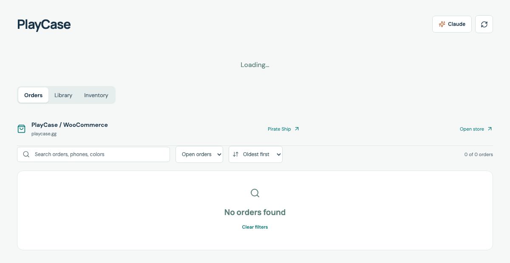
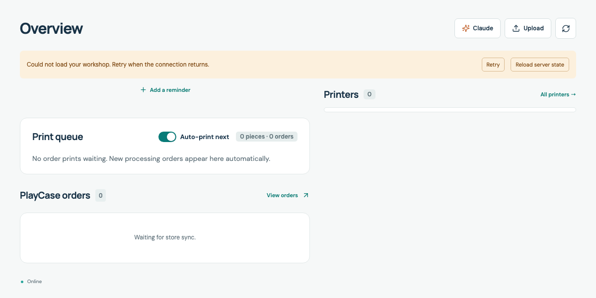
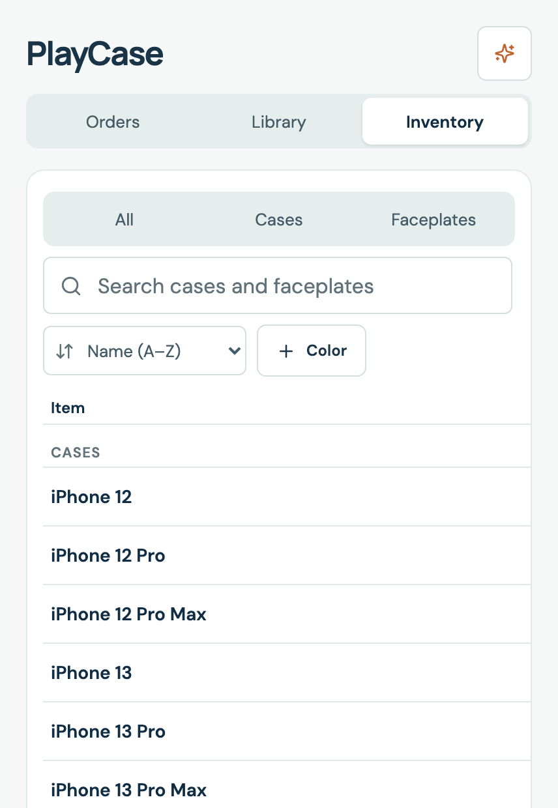
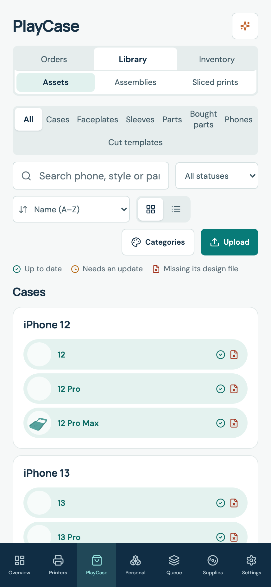
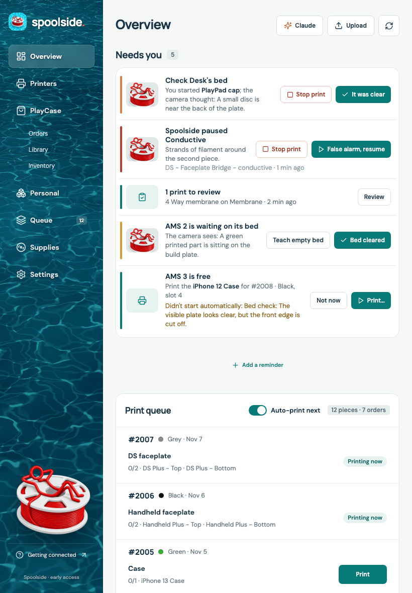
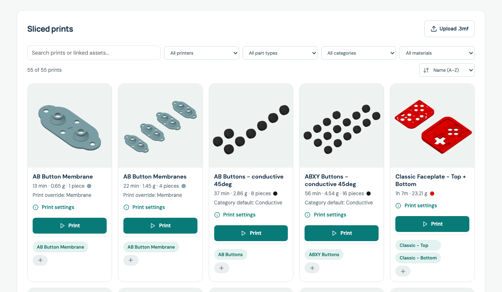
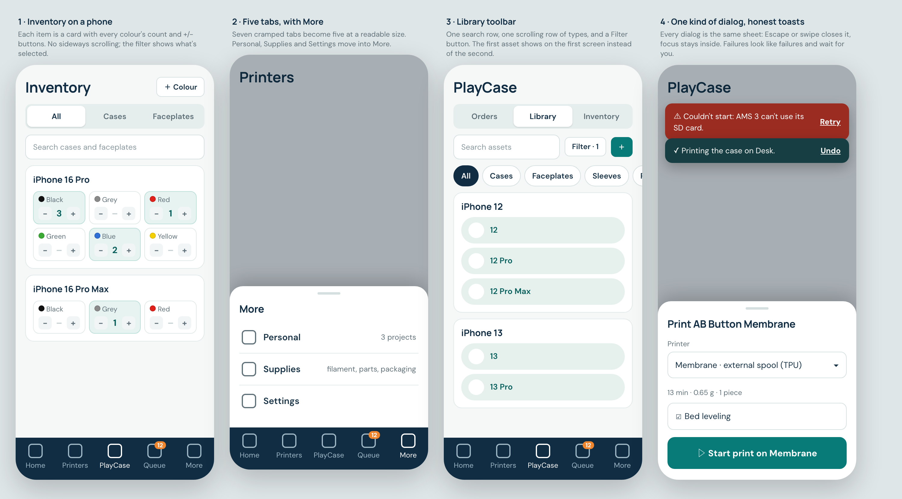
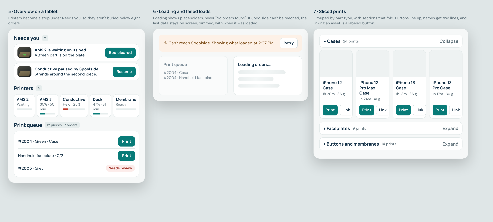

# UI and UX pass: shared foundations, phone and tablet layout, state handling

Issue: https://github.com/shelbyklein/spoolside/issues/33
Baseline: `origin/main` at `02e1ef6` (after PR #32). Reviewed 2026-11-11.

## Summary

Spoolside's screens were built one feature at a time, so the same thing is done several ways: 13 dialogs with three behaviors, one toast for both success and failure, 26 font sizes, and layouts tuned for desktop and phone but not the sizes in between. This pass gives the app one set of building blocks (dialog, toast, confirm, size and colour tokens), fixes the broken states found in the review, and reshapes the phone and tablet layouts where content is cut off or buried. Nothing about printing, bed checks, orders or data changes.

## Problem (what happens today)

Evidence comes from a capture of every page, dialog and state at 1440, 820 and 428 px wide, using live data read-only. Measurements are in [audit-measurements.json](assets/ui-ux-pass-2026-11/audit-measurements.json) and [audit-dialogs.json](assets/ui-ux-pass-2026-11/audit-dialogs.json).

**Broken or misleading**

| # | What happens | Evidence |
|---|---|---|
| P1 | On the phone home, the Upload menu opens *behind* the printer pills and can't be read. |  `src/style.css:2864`, `:2323` |
| P2 | A failed action shows the same green-check toast as a success, and it disappears after 4.5 s. |  `src/main.tsx:1004`, `:287` |
| P3 | While orders load, the page says "Loading…" and "No orders found · Clear filters" at once. |  `src/main.tsx:689`, `src/OrderWorkspace.tsx:106` |
| P4 | When Spoolside can't be reached, the page looks like an empty workshop: 0 orders, 0 printers, auto-print shown on. |  |
| P5 | Inventory on a phone: the colour columns are off-screen (674 elements past the right edge at 428 px, 513 at 820 px), and the All / Cases / Faceplates filter never shows which is selected. |  `src/Inventory.tsx:93` sets `active`; the style is `.segmented button.selected` (`src/style.css:1683`) |
| P6 | Phone Library: 81 elements run past the right edge on Assets and 8 on Sliced prints. 33 asset names are cut off on desktop. | audit `m-library-assets`, `m-library-sliced`, `d-library-assets` |
| P7 | The asset detail's status is two icon-only buttons with no visible label. Photo links in Needs you lose their name when the photo fails to load (corrected in A1: they are named while the photo shows). | `src/AssetLibrary.tsx:254` |

**Inconsistent**

| # | What happens | Evidence |
|---|---|---|
| P8 | The app has 16 dialogs (A1's count; the review opened 12). Escape closes 10, focus stays inside 2, and focus returns to the button that opened it in 1. On desktop the page behind still scrolls. | `tests/ui-audit.spec.ts` `KNOWN`; `modal-backdrop` is hand-written in 6 files |
| P9 | 12 actions (stop print, delete, resume all) use the browser's plain `confirm()` box. | `grep -n "confirm(" src/*.tsx` |
| P10 | The stylesheet has 26 font sizes (8 to 34 px), 199 colours (130 used once), 17 corner radii, 11 stacking levels and only 6 shared variables. `DESIGN.md` names a far smaller set. | `src/style.css` (2,973 lines) |
| P11 | On the phone, many controls are under the 44 px that `DESIGN.md` requires (20 on home, 69 on Orders, 227 on Inventory), tab labels and much of Supplies are under 12 px, and grey meta text (`#8a9aa0`) is too faint on white. | audit `smallTap`, `tinyText`, `lowContrast`; `src/style.css:2812`, `:2840` |

**Hard to use**

| # | What happens | Evidence |
|---|---|---|
| P12 | The phone bottom bar has 7 tabs. |  `src/main.tsx:121` |
| P13 | On a tablet (761 to 1150 px) the Overview is one column and Printers starts 3,560 px down, under every order. |  |
| P14 | The desktop Overview lists each order's pieces twice: in the print queue and again in the orders list. On the phone, 8 orders take 2,983 px because every checklist is open. | audit `d-overview` 3,512 px, `m-orders` |
| P15 | On the phone Library, the toolbar fills the top 560 px of a 926 px screen before the first asset. | same screenshot as P12 |
| P16 | Sliced prints is one flat grid of 55 cards: 5,765 px tall on desktop, 14,885 px on a tablet. Buttons sit at different heights and linking an asset is an unlabeled "+". |  |
| P17 | Supplies is 6,049 px tall on a phone with 95 pieces of text under 12 px. The printer details panel needs scrolling to reach Start a print. | audit `m-supplies` |

## Target

Mockups show layout and behavior. Colours, fonts and artwork stay as `DESIGN.md` defines them.

## Settled decisions

- Phone bottom bar becomes 5 tabs: Home, Printers, PlayCase, Queue (with a count), More. Personal, Supplies and Settings open from More. (Shelby, 2026-11-11)
- Phone Orders rows start collapsed and open on tap. (Shelby, 2026-11-11)
- Overview orders become one-line rows; the full checklist stays on the Orders page. (Shelby, 2026-11-11)
- Work is linear, on one branch, in two PRs. Models are Opus and Sonnet as Shelby asked.

## Success criteria

| # | Outcome | How it's verified |
|---|---|---|
| S1 | No page has content past the right edge, a phone control under 44 px, phone text under 12 px, text below 4.5:1 contrast, or an unnamed control. | `npx playwright test tests/ui-audit.spec.ts` passes with an empty known-failures list at 1440, 820 and 428 px |
| S2 | All 16 dialogs close with Escape, keep focus inside, return focus to their opener, and stop the page behind from scrolling. No `confirm(` remains in `src/`. | the dialog section of the same spec; `grep -c "confirm(" src/*.tsx` is 0 |
| S3 | Failures look like failures and stay until dismissed; loading never shows an empty message; a failed load keeps the last data visible. | `tests/states.spec.ts` |
| S4 | Tablet Overview shows printers within the first 900 px (now 3,560). Phone Orders with 8 orders is under 1,400 px (now 2,983). Sliced prints on a tablet is under 6,000 px fully open (now 14,885). Phone Supplies is under 3,000 px (now 6,049). | assertions in the specs each task adds |
| S5 | Nothing else changed: both existing suites pass, and the five everyday flows work on Shelby's phone after each deploy. | `node --test server/*.test.mjs` (120), `npx playwright test` (45 plus new), then Shelby's check on the live app |

## Deliverables

| Item | End state |
|---|---|
| This plan and its assets | committed on the branch in T0, merged with PR 1 |
| PR 1: foundations and fixes (T0 to B4) | merged to `main`, deployed to the Beelink |
| PR 2: layout and page polish (C1 to E1) | merged to `main`, deployed to the Beelink |
| `tests/ui-audit.spec.ts`, `tests/states.spec.ts`, updated specs | merged with the PR that adds them |
| `DESIGN.md` updated (tokens, dialog, toast, phone nav) | merged with PR 2 |
| Issue checklist | each box ticked when its task's check passes; issue closed after Shelby's check of PR 2 |

## Workflow

Tasks run one at a time, in this order. "Model" is who does the task.

| ID | Model | Task | Passes when |
|---|---|---|---|
| T0 | Opus | Create worktree `/Users/shelbyklein/Vibes/worktrees/ui-ux-pass` on branch `claude/ui-ux-pass` from `origin/main`; `npm ci`; commit this plan and assets; run both suites. | 120 server and 45 browser tests pass on the untouched branch |
| A1 | Opus | Add `tests/ui-audit.spec.ts`: loads every page at 1440, 820 and 428 px with mock data and checks S1 and S2. Start with a `KNOWN` list of today's failures so it passes; later tasks delete their entries. | spec passes; `KNOWN` matches the Problem tables |
| A2 | Opus | Tokens in `src/style.css`: type scale (12, 13, 14, 16, 19, 24, 30), named colours including state pills, radii (6, 10, 14, 999), stacking layers. Replace literals with tokens; snap near-duplicates. Muted text meets 4.5:1. | at most 9 distinct `font-size` values and 8 `z-index` literals; `lowContrast` is 0 on Overview, Queue and Printers; before/after screenshots show no layout shift over 2 px |
| A3 | Opus | `src/Dialog.tsx`: one dialog (label, Escape, focus kept inside and returned, page scroll locked, backdrop closes unless busy; a bottom sheet at 760 px and under, full screen for large ones). Move all 16 dialogs onto it. | S2's dialog checks pass 16 of 16; dialog entries removed from `KNOWN` |
| A4 | Opus | Toasts and confirm: `notify(message, { kind, action })`. Errors use an alert icon and `role="alert"` and stay until dismissed; successes clear after 4.5 s; toasts sit above the tab bar. Replace all `confirm()` calls with an in-app confirm (danger style for stop and delete). | an error toast is still visible after 6 s and has Dismiss; `grep -c "confirm(" src/*.tsx` is 0; specs that used `page.on('dialog')` click the in-app confirm |
| A5 | Opus | Global minimums at 760 px and under: buttons, tabs, inputs and icon buttons at least 44 px; text at least 12 px; one visible keyboard focus ring everywhere. | `smallTap` and `tinyText` are 0 at 428 px on home, Printers, Queue, Orders and Settings |
| B1 | Sonnet | Phone home Upload menu opens above the printer pills (as a sheet from A3) with readable items. | at 428 px, the element at each menu item's centre is that item |
| B2 | Sonnet | States: while loading, show placeholder rows and no empty message or zero counts; when a load fails after a good one, keep the last data dimmed under "Can't reach Spoolside. Showing what loaded at …" with Retry; no printers at all gets its own message, on the Printers page and the phone home. Add `tests/states.spec.ts`. | S3 passes: delayed load shows no "No orders found"; a 500 after a good load keeps the earlier orders visible |
| B3 | Sonnet | Inventory: fix the filter's selected style; at 1100 px and under show each item as a card with every colour's count and + / − buttons. | 0 elements past the right edge at 428 and 820 px; selected filter is visibly marked; + sends the same PUT as typing a count |
| B4 | Sonnet | Library overflow and names: nothing past the right edge on Assets and Sliced prints at 428 px; asset and job names wrap to two lines; photo links get names; asset status buttons show "Up to date" / "Needs an update". | `offRight`, `clipped` and `unnamed` are 0 on Library pages; entries removed from `KNOWN` |
| G1 | Shelby | **Gate:** PR 1 is merged and deployed; Shelby checks the live app on the phone. | Shelby says it's fine to continue |
| C1 | Opus | Phone bottom bar: Home, Printers, PlayCase, Queue (count badge), More. More is a sheet with Personal, Supplies, Settings and marks itself selected on those pages. Routes don't change. | at 428 px there are 5 tabs with labels at least 12 px; `/settings` opens with More selected; nav steps in existing specs updated |
| C2 | Opus | Tablet Overview (761 to 1150 px): a five-tile printer strip directly under Needs you. | at 820 × 1180 the Printers region starts above 900 px |
| C3 | Sonnet | Orders: Overview shows one-line rows (number, phone and colour, "2 of 3 printed", Ship when ready) that open the order on the Orders page. Phone Orders rows start collapsed and open on tap. | no checkbox inside the Overview's orders region; phone Orders with 8 orders is under 1,400 px; tapping a row reveals its Print buttons |
| C4 | Sonnet | Phone Library toolbar: search, Filter and add on one row; part types in one sideways-scrolling row; status, sort and view inside Filter. | at 428 px the first asset starts within 430 px of the top (now 560) |
| D1 | Sonnet | Sliced prints: group by part type in sections that fold and remember their state; cards in a row share button positions; "+" becomes "Link asset"; at least 3 columns at 820 px. | tablet page under 6,000 px with every section open; Print buttons in a row share one top edge |
| D2 | Sonnet | Supplies: each printer's spools fold to one line; each filament shows its two best offers with "Show all"; text at least 12 px. | phone page under 3,000 px; `tinyText` is 0 on Supplies |
| D3 | Sonnet | Printer details: Bed check and Start a print become folding sections, each with a one-line summary. | at 1440 × 900 the panel fits without scrolling when sections are closed |
| D4 | Sonnet | Assemblies and Claude: row controls reach 44 px on phones and have names; "Preview unavailable" meets contrast; the empty Claude chat offers three tappable starter questions. | `smallTap` and `lowContrast` are 0 on Assemblies at 428 px; tapping a starter sends it |
| E1 | Opus | Empty the `KNOWN` list; run every suite; update `DESIGN.md`; save before/after screenshots from mock data. | S1 to S4 all pass |
| G2 | Shelby | **Gate:** PR 2 is merged and deployed; Shelby runs the five-flow check and closes the issue. | S5 confirmed |

### How the two models work together

The coordinating session owns the branch. For each task it starts one agent on the task's model (Opus 5.5 or Sonnet 5.5) with that task's row, the brief below and the files named there, waits for it, reads the diff, runs the test gate, and commits. One task at a time, never two agents at once: almost every task edits `src/style.css` or `src/main.tsx`, and parallel builds overload this Mac.

### Briefs for the Sonnet tasks

Every brief also carries: work only in `/Users/shelbyklein/Vibes/worktrees/ui-ux-pass`; use the tokens, `Dialog` and `notify` from A2 to A4, never new literals or hand-written backdrops; keep existing `aria-label`s unless the task changes them; no server changes; never call a real printer; report what changed and the test output.

- **B1:** `src/main.tsx` (`overviewUploads`), `src/WaterHome.tsx`, `src/style.css` (`.upload-menu*`, `.home-pills`).
- **B2:** `src/live-workspace.ts` (keep the last good data and its time), `src/main.tsx:683-700`, `src/OrderWorkspace.tsx:106`, `src/PrinterCards.tsx:149`, `src/WaterHome.tsx`.
- **B3:** `src/Inventory.tsx`, `src/style.css` (`.inventory*`). Reuse the existing `PUT /api/inventory`.
- **B4:** `src/AssetLibrary.tsx`, `src/PrintControls.tsx` (sliced grid), `src/PrinterCards.tsx`, `src/BedCheck.tsx` and `src/PrintWatch.tsx` (photo links).
- **C3:** `src/OrderWorkspace.tsx` (`OrderRow`), `src/main.tsx` (Overview orders), `tests/live.spec.ts`, `tests/orderprint.spec.ts`.
- **C4:** `src/AssetLibrary.tsx:136-172`, `src/style.css`.
- **D1:** `src/PrintControls.tsx:340-420`; remember open sections in `localStorage` under `spoolside-sliced-sections`.
- **D2:** `src/Supplies.tsx`, `src/FilamentManager.tsx`, `src/LoadedSpools.tsx`.
- **D3:** `src/main.tsx` (detail panel), `src/BedCheck.tsx`, `src/PrintControls.tsx`.
- **D4:** `src/Assemblies.tsx`, `src/ClaudeChat.tsx`.

## Scope boundaries

Not in this plan:
- Any server, API, database or MCP change.
- Bed checks, print starting, auto-print, repeat, order sync or costs: behavior stays exactly as it is.
- Dark mode, new features, new pages, or a new visual identity. The water home artwork, desktop sidebar and sign-in page stay as they are.
- The `codex/cricut-svg-14` and `codex/tokenledger` branches and their worktrees.

Must not change:
- Stored data, routes and URLs, and what each button does.
- `handoff/` stays untracked. Screenshots that go into the repo come only from mock data: no camera photos, no real orders.
- Tests never start a real print.

## Rollback

There is no data or schema change, so nothing needs restoring; the app's hourly database backups continue as usual. To undo a deploy, check out the previous `main` commit, repeat the usual rsync of `src/` and `server/` to the Beelink, and run `docker compose -f compose.yaml -f tunnel-compose.yaml up -d --build`. Each PR can be reverted on its own; PR 2 depends on PR 1, so revert PR 2 first.

## Test plan

- Server: `node --test server/*.test.mjs` (expect 120 passing, unchanged).
- Browser: `npm run build && npx playwright test` (45 existing specs, plus `ui-audit.spec.ts` and `states.spec.ts`).
- Types: `npx tsc --noEmit -p .`
- Rendered check: the audit spec opens the real pages (`/overview`, `/printers`, `/orders`, `/queue`, `/library`, `/library/assemblies`, `/library/sliced`, `/inventory`, `/personal`, `/supplies`, `/settings`, and `/` on the phone) at three widths and measures the rendered result, then opens each dialog from its real button.
- Shelby's five-flow check on the phone after each deploy: answer a Needs you row; start a print from the queue; open a printer's details and resume or stop; change an inventory count; ask Claude a question.

## Open questions

None blocking. For later, outside this plan: dark mode, and whether the Overview should show today's finished prints.

## Work preparation

- Scope: confirmed by Shelby on 2026-11-11 (review every view and state, suggest improvements, plan for Opus and Sonnet), with the three decisions above.
- Plan: this file. Issue: see top.
- Mode: `linear`. Reason: nearly every task edits `src/style.css` or `src/main.tsx`, and parallel builds overload the Mac.
- Models: Opus 5.5 (`claude-opus-5-5`) for T0, A1 to A5, C1, C2, E1; Sonnet 5.5 (`claude-sonnet-5-5`) for B1 to B4, C3, C4, D1 to D4. Effort: not specified by Shelby; each session's default. Planned by Fable 5.2 (`claude-fable-5-2`).
- Now or later: now (Shelby, 2026-11-11). This authorizes both PRs, their merges and deploys, with Shelby's phone check after each.
- Coordinator: the planning session (Fable 5.2) owns the branch, hands each task to an Opus 5.5 or Sonnet 5.5 agent as assigned, reviews the diff, runs the gate and commits. T0 is setup done by the coordinator.
- Readiness: pass · 2026-11-11 · R1 to R13 checked, none n/a.
